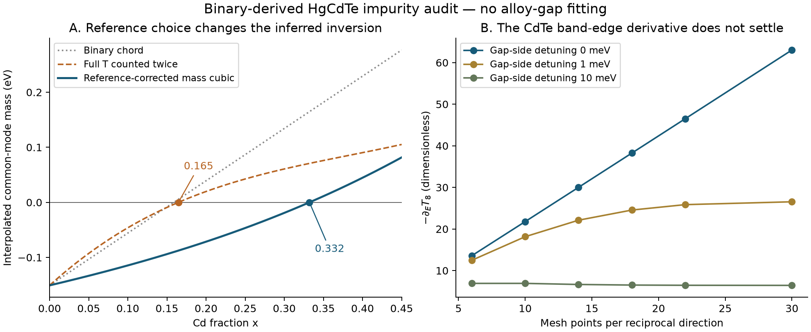

# Exact impurity diagnostic: the static pathology survives and a false root is exposed

**CALCULATED:** nonperturbative single-impurity resummation does not repair the
static discrepancy of the reconstructed binary-derived vertex. Correctly
referenced endpoint reductions give roots near 0.33–0.35. A convention error
gives a misleading root near 0.165 from the same T matrices.

**PROVEN:** the full versus residual T distinction is an exact Dyson
re-referencing identity. A separate threshold theorem shows why finite T values
do not guarantee finite endpoint T derivatives or bounded smooth Hermite
remainders. **No replacement for Hansen is established.**

## Source, Hamiltonian and impurity definition

The binary parameters are transcribed from Table 2.2 of
[Christoph Schindler's 2012 dissertation](https://www.osti.gov/etdeweb/servlets/purl/21595032).
The model has nine orbitals per atom, p-orbital SOC in the source convention,
nearest-neighbor Slater–Koster hopping, and 36 spinor states per cell. No d-d
hopping values are listed, so those elements are zero. The reconstructed
Gamma8 levels are aligned, then the source's 0.4 eV valence offset places CdTe
below HgTe. The source describes binary fitting targets and a subsequent VCA
alloy check. This is a published semiempirical binary model.

The impurity support is one substituted cation and its four neighboring Te
atoms: 90 spinor orbitals. Cation onsite and four bond contrasts are taken in
full; each Te receives one quarter of the binary Te onsite/SOC contrast. The
resulting vertex satisfies

\[
B(k)^\dagger V B(k)=H_C(k)-H_H(k)
\]

at every tested k. This makes its uniform limit unambiguous, but does not make
it a physical self-consistent impurity potential. Additional electronic response,
longer-range changes and electrostatic tails are absent.

The exact lattice T is \((1-Vg)^{-1}V\), with g obtained by BZ integration.
The derivative is computed from the spectral squared denominators, retaining
the entire host Hilbert space. Even midpoint reciprocal grids exclude an
artificial discrete Gamma pole. Finite eta and finite meshes are recorded.

## Binary reconstruction checks

| Quantity | Calculated |
|---|---:|
| HgTe signed Gamma6–Gamma8 gap | -0.301570879 eV |
| CdTe signed Gamma6–Gamma8 gap | +1.598134523 eV |
| Binary span | 1.899705402 eV |
| Binary chord root | 0.158746 |
| Source-model VCA root | 0.181661245 |

The Gamma gaps reproduce the source targets to their displayed precision.
X and L energy checks agree within 25 meV, consistent with the rounded
published table. This validates reconstruction for a diagnostic; it does not
certify finite-q accuracy at the few-meV level.

## Static and dynamic results

The following common-mode projections use the host Gamma-sector states, one
common energy (E6+E8)/2, a 30^3 grid and eta=50 meV. Entries are **gap-channel
coefficients per dilute concentration**, not physical shifts at an interior x.

| Impurity / host | First Born | Second Born alone | Exact full T | Exact minus first Born |
|---|---:|---:|---:|---:|
| Cd / HgTe | +1.60054 | -1.29850 | +0.67126 | -0.92928 |
| Hg / CdTe | -2.15682 | -0.94584 | -3.90037 | -1.74355 |

Units: eV. Resummation reduces the Hg-host excess correction by about 28%,
while increasing the Cd-host excess magnitude by about 84%. There is no
order-of-magnitude collapse of the static pathology in this defined model.

At the same common energies the symmetric real negative T derivative is
0.37964 in HgTe and 0.59615 in CdTe. These are pointwise T diagnostics, not
the reciprocal-law A. On the Hg side eta=20 meV gives 0.41001 at mesh 30,
versus 0.26530 at mesh 22: derivative convergence is substantially more
delicate than the static T values. The positive cloud norm -Im(T_s)/eta is
0.52926 at eta=50 meV, rather than 0.37964. The distinction matters inside
the continuum.

At real CdTe mid-gap energy, the Hermitian PSD check passes and the two
definitions coincide. The common symmetric derivative converges to about
0.59808. The local-only g^2 shortcut omits host excursions and gives a
smaller norm; independent finite-Hamiltonian tests verify the correct formula.

## Freeze of the two endpoint reductions

For the principal diagnostic tranche (30^3, eta=50 meV), the full common-mode
mass shifts are

\[
\tau_H=+0.335629714\ \mathrm{eV},\qquad
\tau_C=-1.950187232\ \mathrm{eV}.
\]

With \(\Delta M=0.949852701\) eV, the residual shifts are
\(t_H=-0.614222987\) and \(t_C=-1.000334531\) eV. Using their real parts
in the corrected endpoint cubic gives

\[
\mu_3(x)=-0.150785439+0.335629714x
 +0.228111443x^2+0.386111544x^3\quad\mathrm{eV},
\]

and its root is **0.332135822**. This is a finite-eta Hermitian-part endpoint
interpolant. It is not a solved self-consistent interior mass or a complex-pole
crossing prediction. The common-mode T projections have nonzero imaginary
parts, which are preserved in the archived data.

The actual branch-pole endpoint projections instead give

\[
g_0=0.776029884\ \mathrm{eV},\qquad g_1=5.991669746\ \mathrm{eV}.
\]

Their reciprocal boundary completion has
\(A=1.562499546\), \(C=-1.594879879\) eV and root **0.349654506**.
It is an endpoint reduction, not evidence that A is the true dynamic
susceptibility. The two roots differ by about 0.0175, so the leading closures
do not pass the proposed internal consistency target in this model.

If the full shifts are inserted as though they were residual shifts, the
incorrect expression adds \(\Delta M k(1-2x)\). Its root is **0.164640493**.
The improvement is entirely from counting the coherent contrast twice.

## Convergence and offset sensitivity

| Mesh | eta (meV) | Correct mass cubic root | Branch-pole reciprocal root |
|---:|---:|---:|---:|
| 14 | 50 | 0.332302 | 0.349818 |
| 22 | 50 | 0.332125 | 0.349740 |
| 30 | 50 | 0.332136 | 0.349655 |
| 22 | 20 | 0.332898 | 0.353401 |
| 30 | 20 | 0.332814 | 0.353419 |

The eta change is a prescription sensitivity, not an experimental uncertainty
bar. No eta->0 extrapolation is claimed for the HgTe continuum.

At mesh 14 and eta=50 meV, changing the documented offset across 0.35–0.50 eV
gives mass roots 0.34120–0.31641 and reciprocal roots 0.35874–0.33414.
It does not remove the discrepancy. The offset was not tuned to alloy gaps.

## The insulating endpoint also has a threshold problem

Evaluate Hg-in-CdTe at the host Gamma8 energy, approaching from the gap side.
At exactly zero detuning, the even mesh supplies an infrared cutoff.

| Mesh | T8 (eV) | -T8 prime |
|---:|---:|---:|
| 6 | 1.27635 | 13.5836 |
| 10 | 1.28721 | 21.7804 |
| 14 | 1.29378 | 30.0116 |
| 18 | 1.29804 | 38.2540 |
| 22 | 1.30101 | 46.5049 |
| 30 | 1.30488 | 63.0225 |

The static value remains finite while the derivative grows approximately
linearly with the reciprocal grid resolution, consistent with the quadratic
threshold theorem. At a 10 meV gap-side detuning, the derivative instead
settles near 6.44. This rules out treating the unqualified endpoint T8 prime
as a converged O(0.4) scalar in the reconstructed model.

This observation does not establish a fractional HgCdTe composition law.
The [conditional derivation](../../../docs/derivations/impurity_reference_and_threshold.md)
provides an exact x^(3/2) counterexample under independent-impurity closure.
Self-consistent CPA can change the concentration asymptotics; additional
channel selection and band structure can change the threshold power. The
next calculation must resolve those conditions rather than assume smoothness.



## Reproduction and validation

```bash
python3 -m venv .venv
.venv/bin/python -m pip install numpy pytest matplotlib
PYTHONPATH=src OPENBLAS_NUM_THREADS=1 .venv/bin/python tools/run_sp3d5_impurity_diagnostic.py
PYTHONPATH=src OPENBLAS_NUM_THREADS=1 .venv/bin/python tools/run_sp3d5_impurity_diagnostic.py --mesh 18 22 --eta .05 .02 .01 --output data/calculated/sp3d5_impurity_refinement.json
PYTHONPATH=src OPENBLAS_NUM_THREADS=1 .venv/bin/python tools/run_sp3d5_impurity_diagnostic.py --mesh 30 --eta .05 .02 --output data/calculated/sp3d5_impurity_mesh30.json
PYTHONPATH=src OPENBLAS_NUM_THREADS=1 .venv/bin/python tools/check_sp3d5_threshold.py
PYTHONPATH=src .venv/bin/python tools/summarize_sp3d5_impurity_diagnostic.py data/calculated/sp3d5_impurity_diagnostic.json data/calculated/sp3d5_impurity_refinement.json data/calculated/sp3d5_impurity_mesh30.json data/calculated/sp3d5_impurity_offset035.json data/calculated/sp3d5_impurity_offset050.json data/calculated/sp3d5_scattering_geometry.json
MPLCONFIGDIR=.cache/matplotlib PYTHONPATH=src .venv/bin/python tools/plot_sp3d5_impurity_audit.py
PYTHONPATH=src OPENBLAS_NUM_THREADS=1 .venv/bin/python -m pytest
```

Offset sensitivity tranches use --mesh 14 --eta .05 .02 and --offset .35 or
.50. Geometry uses --mesh 10 --eta .05. Their --output paths match the files
above. Early tranches predate extra cloud-geometry fields; regenerating them
adds those fields without changing the underlying scalar calculation.

Environment: Python 3.13, NumPy 2.5.3, pytest 9.1.1; optional plot rendering
uses matplotlib 3.11.2. Source PDF SHA256 and parameter-file SHA256 are
archived. Derived summaries pin their input-data hashes.

Final full test suite: **1764 passed**. The 16 new tests cover source band
checks, SOC, symmetry, uniform finite-q closure, exact finite-host Dyson
inversion, independent energy differences, optical theorem, true embedded
norms, the corrected chord limit, continuum sign counterexample and threshold
quadrature/concentration scaling. Optical-theorem relative residuals are below
6e-16; causality violations are only roundoff (below 5e-16).

## Decision

**HYPOTHESIS:** a self-consistent physical impurity potential could still
spectrally rebalance the static mass and retain dynamic dressing. This
diagnostic establishes neither that outcome nor the required local Te scale.

The binary-derived vertex is not accepted as a physical gap predictor. The
next physical input is the common-gauge self-consistent substitution potential,
not an empirical counterterm. Use corrected references, preserve complex
continuation data and check threshold regularity before the endpoint-curvature
hierarchy. Temperature remains deferred.

**NOVELTY CANDIDATE:** none substantiated. These are established identities
applied to expose a concrete failed prediction protocol and a threshold
limitation. No new material discovery or publication priority is claimed.
