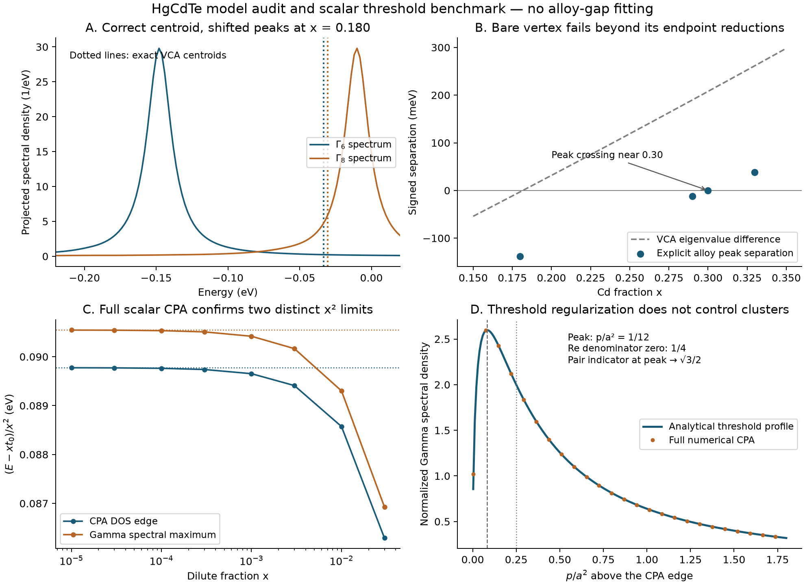

# Direct alloy spectra and threshold self-consistency

**CALCULATED:** the reconstructed bare vertex retains a substantial static
gap error when solved directly in random-alloy supercells. Its Gamma spectral
peaks meet near x=0.30, rather than the model's VCA crossing at x=0.18166.
Thus the failure is not confined to the endpoint interpolants in the
[preceding audit](result_2026-10-10.md).

**PROVEN under stated models:** (1) the Gamma spectral centroid is exactly
VCA for every configuration of the fixed linear-substitution Hamiltonian;
(2) self-consistent scalar CPA converts the independent-host threshold
x^(3/2) edge correction into x^2; (3) its DOS edge, Gamma spectral maximum
and real-denominator root have different x^2 coefficients; (4) the conventional
omitted-cluster indicator remains order one in that threshold layer.

These results refine the microscopic calculation protocol. They do not
establish a replacement HgCdTe gap equation or a historical novelty claim.

## Frozen lattice model and observable

The binaries and alignment are unchanged from the preceding audit:
[Schindler's Table 2.2](https://www.osti.gov/etdeweb/servlets/purl/21595032),
p SOC, nearest-neighbor s/p/d bonds, and a 0.4 eV valence offset. At every
cation, its species sets the onsite and four bond matrices. Each Te onsite
matrix is the arithmetic mean of its four neighbors' binary Te matrices.
This is exactly the finite-alloy version of the earlier quarter-share star.
No induced nonlinear Te response or electronic self-consistency is added.

Each periodic box has n^3 primitive cells and 36 n^3 spinor orbitals. The
two sizes are n=8 (18,432 orbitals) and n=12 (62,208). Cation occupation is
uniformly random conditional on a fixed number of Cd atoms, with seeds 310
and 711. Composition is therefore the achieved fraction, rather than the
nominal target. This finite canonical ensemble approaches local Bernoulli
statistics as the box grows, but is not exactly an independent Bernoulli
ensemble at finite size.

The observable is the maximum of the ensemble-averaged Gamma-sector
spectral density. Uniformly embedded VCA Gamma6 and Gamma8 states define
the sectors; the traces average over their two and four states. A sparse
Hermitian Lanczos continued fraction evaluates their complete finite-cell
Green functions, including repeated scattering, to the checked iteration
accuracy. The energy sampling interval is 2 meV. Peak searches span the
corresponding VCA edge plus or minus 0.7 eV; no reported peak touches that
boundary. This is a spectral-peak proxy, not an exact topological invariant,
an absorption threshold or a strict random-alloy spectral-support gap.

## Interior calculation

| Achieved x, n=12 | VCA Gamma6-minus-Gamma8 (meV) | Ensemble peak separation (meV) |
|---:|---:|---:|
| 0.179977 | -2.894 | -138 |
| 0.289931 | +189.784 | -12 |
| 0.299769 | +207.390 | 0 at the sampling resolution |
| 0.329861 | +261.611 | +38 |

The n=8 boxes at x approximately 0.18 and 0.33 give the same ensemble
separations, -138 and +38 meV. Individual seeds differ by at most 2 meV.
At n=12, cached 1000-step Lanczos coefficients re-evaluated at eta=5, 10,
20 and 50 meV give the same separation at both x approximately 0.18 and
0.30. Halving the iteration count to 500 changes neither sector peak at
the 2 meV energy-grid resolution. Older 800-versus-400 checks have at most
a 2 meV shift. These are bounded numerical checks, not experimental error
bars or a rigorous thermodynamic-limit extrapolation.

The failure magnitude around x=0.18 is approximately 135 meV relative to
the same model's VCA. It survives explicit disorder and the tested finite-size,
iteration and broadening controls. No empirical alloy point was used to
change a parameter. Nor is an equation fitted to these calculated points.

The exact Gamma centroid equals the VCA energy to below 2e-14 eV in all
sampled cells. This validates the uniform Hamiltonian construction while
demonstrating that the first spectral moment does not determine its main
peak. The [derivation](../../../docs/derivations/self_consistent_threshold_and_centroid.md)
states the matrix sum rule and its fixed-linear-response assumption.

## Self-consistent threshold benchmark

A separate, dimensionally explicit scalar CPA model uses a normalized
square-root DOS on [0,1] eV and an artificial impurity potential -0.1 eV.
It supplies no material coefficient. Define g(w)=g0+c sqrt(-w)+O(w),
D0=1-vg0, t0=v/D0, a=c t0^2, b=-g0 t0^2/D0. The inner equation is

\[
E=xt_0+x^2\zeta,\qquad E-\Sigma=x^2u,\qquad
\zeta=u+a\sqrt{-u}+b.
\]

Consequently the three leading locations are

\[
E_{\rm CPA\ edge}=xt_0+(b+a^2/4)x^2+O(x^3),
\]

\[
E_{\Gamma\ peak}=xt_0+(b+a^2/3)x^2+O(x^3),
\]

\[
E_{\operatorname{Re}G_\Gamma^{-1}=0}
=xt_0+(b+a^2/2)x^2+O(x^3).
\]

Full numerical CPA solutions independently recover the first two
coefficients as concentration decreases. This disproves the inference
that divergent isolated-host T prime necessarily imposes x^(3/2) on a
self-consistent composition law. The preceding x^(3/2) calculation remains
a valid counterexample for its declared independent-host approximation.

The conventional off-site cluster indicator tends to 1 at the CPA edge
and sqrt(3)/2 at the Gamma peak. Neither decreases with concentration in
the inner layer. This indicator is heuristic, not a rigorous relative error
estimate. The generic CPA-edge applicability problem, including the unity
limit, is established prior art: [Skrypnyk, 2004](https://journals.aps.org/prb/abstract/10.1103/PhysRevB.70.212201).
Therefore smooth CPA asymptotics do not justify discarding clusters or
equating its sharp DOS edge to an exact alloy edge.



## Reproduction and validation

```bash
.venv/bin/python -m pip install scipy matplotlib
PYTHONPATH=src OPENBLAS_NUM_THREADS=1 .venv/bin/python tools/run_sp3d5_random_alloy.py --side 8 --composition .18 .33 --seeds 310 711 --steps 800 --output data/calculated/sp3d5_random_alloy_side8.json
PYTHONPATH=src OPENBLAS_NUM_THREADS=1 .venv/bin/python tools/run_sp3d5_random_alloy.py --side 12 --composition .18 .29 .33 --seeds 310 711 --steps 800 --output data/calculated/sp3d5_random_alloy_side12.json
PYTHONPATH=src OPENBLAS_NUM_THREADS=1 .venv/bin/python tools/run_sp3d5_random_alloy.py --side 12 --composition .18 .30 --seeds 310 711 --steps 1000 --eta .01 --output data/calculated/sp3d5_random_alloy_refinement.json
PYTHONPATH=src .venv/bin/python tools/summarize_sp3d5_random_alloy.py
PYTHONPATH=src .venv/bin/python tools/check_scalar_cpa_threshold.py
MPLCONFIGDIR=.cache/matplotlib PYTHONPATH=src .venv/bin/python tools/plot_sp3d5_self_consistency_audit.py
PYTHONPATH=src OPENBLAS_NUM_THREADS=1 .venv/bin/python -m pytest
```

The two earlier random-cell files predate saving Lanczos coefficients;
rerunning them adds coefficients and provenance fields. Their stored density
and peak values remain the same. Derived summaries pin input hashes and
the scalar benchmark pins its numerical module hashes. The archived refinement
contains all coefficients needed for broadening and iteration checks.

Full repository validation: **1773 passed**, including 9 additional tests
for the new modules. Independent checks compare pure-cell eigenvalues with
folded Bloch spectra, a random-cell Lanczos Green function with a full dense
inverse, and the scalar host functions with direct quadrature. The original
binary CPA scattering equation and its implicit derivative are checked
separately from the asymptotic coefficients. Python 3.13, NumPy 2.5.3,
SciPy 1.18.1, pytest 9.1.1, matplotlib 3.11.2.

## Decision and next material calculation

**HYPOTHESIS:** a self-consistent physical Hg/Cd impurity potential could
change the large static projection. The bare binary-derived star does not
establish this; its direct alloy spectrum reinforces the need for that input.
Historical HgCdTe CPA reported weak edge scattering and substantial damping
away from the edges, so simply inheriting binary parameters is not a reliable
material criterion. [Hass, Ehrenreich and Velicky, 1983](https://journals.aps.org/prb/abstract/10.1103/PhysRevB.27.1088).

The next decisive material calculation remains the common-gauge
self-consistent Cd-in-HgTe potential, with the reciprocal CdTe calculation
as a control. Define the spectral observable and the threshold channels
before treating energy derivatives as a finite scalar A or assuming a
regular endpoint-pair Hermite hierarchy. The exact configurational cluster
identities remain intact; it is their mapping onto the full spectral gap
that requires these checks. Temperature remains deferred.

**NOVELTY CANDIDATE:** no priority claim is substantiated. Targeted searches
located established CPA threshold and cluster-applicability theory. The
explicit observable coefficients and application to this HgCdTe prediction
protocol may be useful, but require a broader historical audit before any
novelty assertion. No manuscript is authorized by this result.
